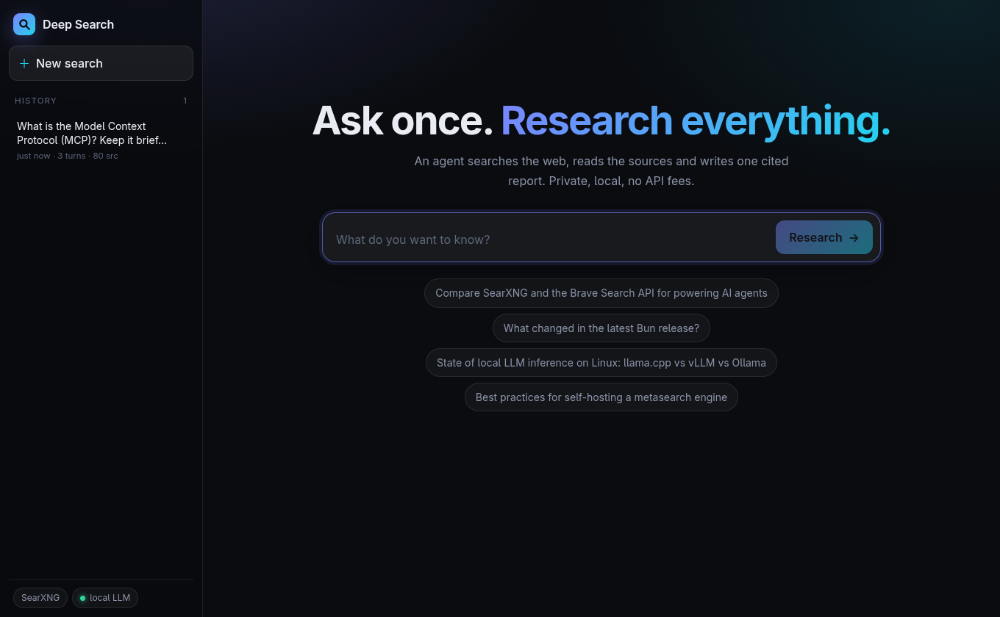
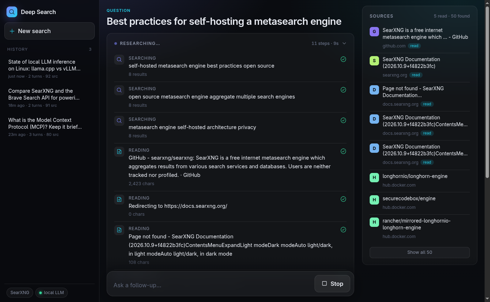
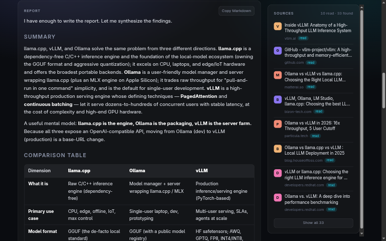
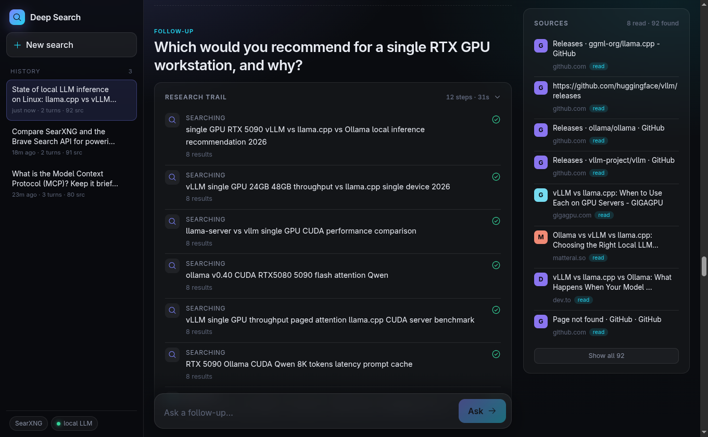

# Deep Search

Agentic web research prototype: ask a question, an agent searches the web (SearXNG), reads sources and
writes one cited Markdown report. Runs fully local.

## How it looks

**1. Ask** — type a question or pick an example. Past searches live in the history sidebar.

**2. Research** — watch the agent search and read sources live; sources fill in on the right.

**3. Report** — one cited Markdown report, with tables and clickable `[n]` citations.

**4. Follow up** — keep asking in the same session; each turn builds on the earlier findings.

## Search history

History is stored **in each user's browser** (`localStorage`, one Markdown document per session under the key
`ds:s:<id>`), never on the server — so it is private per browser/user and the service is stateless
(follow-ups send the previous turns along with the question). Each document has YAML frontmatter with the
metadata (id, title, timestamps, model, counts, questions), then each turn (question, research trail, report),
then a **Citations** appendix listing every source (read vs. only found).

- Sessions are deep-linkable (`#<id>`), survive reloads, and can be deleted from the sidebar (trash icon).
- `localStorage` is per origin: `localhost:2340`, `host:1234/search/` etc. each have their own history.
- Clearing site data removes it; the **Copy** button exports a whole thread as Markdown.
- If browser storage is full or blocked, the UI says so and the session just won't appear in history.

## Parts

- `agent.mjs` — [agl-ai](https://github.com/mikesmullin/agl) agent (`llama-server:default` on :1234) + `web_search` / `fetch_page` tools
- `server.mjs` — stateless Bun server; `POST /api/research` streams progress over SSE
- `public/store.mjs` — session persistence in the browser (Markdown + YAML frontmatter in `localStorage`)
- `public/` — dark, responsive, [Phosphor](https://phosphoricons.com)-iconed [m-js](https://github.com/mikesmullin/m-js) UI (`app.mjs`, `md.mjs`, `style.css`)

## Run

    cp settings.yml.example core-config/settings.yml
    sed -i "s/CHANGE_ME/$(openssl rand -hex 32)/" core-config/settings.yml
    podman-compose up -d                 # SearXNG on :8080
    bun install                          # Phosphor icons
    bun link agl-ai m-js                 # local fs libs (bun link in each repo first)
    bun server.mjs                       # UI on 127.0.0.1:2340
    bun agent.mjs "your question"        # or CLI

Env: `SEARXNG_URL`, `LLM_MODEL` (default `llama-server:default`), `MAX_TOOL_CALLS`, `MAX_TURNS`, `PORT` (2340), `HOST` (127.0.0.1).

## LAN access

The server binds to loopback only. To reach it from your LAN, route a subpath to it from a reverse proxy
(all asset/API URLs are relative, so it works under any prefix, e.g. `https://host:1234/search/` via
aigw).
